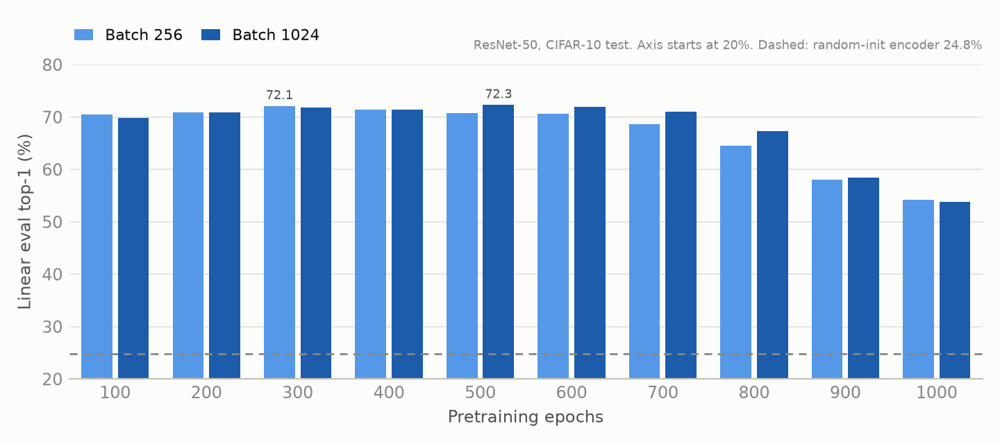
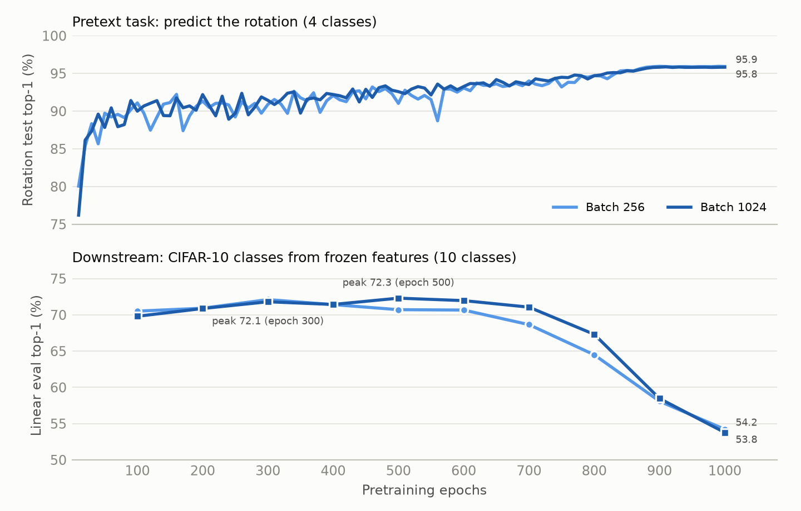
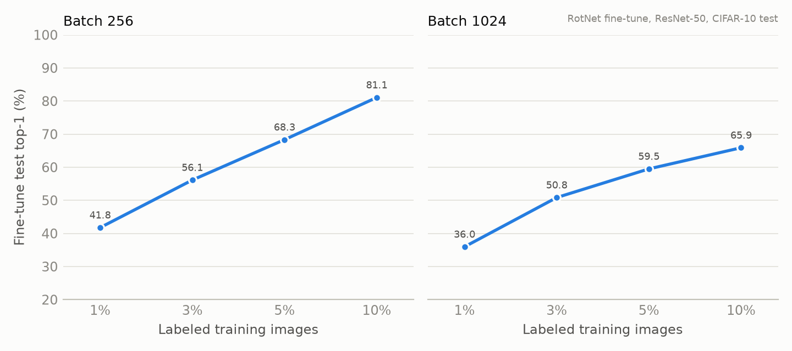

# RotNet · results and the figures to make

This page checks every RotNet result and lists the tables and figures the report
needs so RotNet can be compared with SimCLR on equal terms. The shared settings
and the full run checklist are in the [experiment plan](experiments.md).
Checked 2026-11-25.

## What the project requires

The ECE 661 topic list (Project 4, page 5) sets four basic requirements:

1. Implement SimCLR on CIFAR-10 with the setup in Appendix B.9.
2. Pick a feasible batch size and number of epochs, and run a linear evaluation
   that reproduces the corresponding result from **Figure B.7**.
3. Evaluate limited labels following **Section 6 and Table 7**. Compare SimCLR
   with a supervised baseline and ask whether SimCLR suits limited labels better.
4. Implement RotNet and compare it with SimCLR **using the same two experiments**.

So RotNet needs a Figure B.7 analog and a Table 7 analog built exactly like
SimCLR's, plus a supervised baseline shared by both. The team's
[proposal](references/README.md) adds SimSiam on the same encoder and states
success as "pretraining beats the baseline when labels are scarce".

The report is at most 6 pages plus references, with optional supplementary
material. It is worth 40% of the project grade; the poster and in-person
presentation on Dec 9 are worth 30%, and individual Q&A 20%.

### What SimCLR reports on CIFAR-10

| SimCLR item | What it shows |
|---|---|
| Appendix B.9 setup | ResNet-50 with a 3×3 stride-1 first conv and no max-pool. Batch sizes {256, 512, 1024, 2048, 4096}, LR {0.5, 1.0, 1.5}, temperature {0.1, 0.5, 1.0} |
| B.9 headline | Best linear evaluation 94.0% at batch 1024, against 95.1% for a supervised ResNet-50 "using the same architecture and batch size" |
| Figure B.7 | Grouped bar chart. x axis: training epochs 100–1,000. One bar per batch size in each group. y axis: linear-evaluation top-1 (80–94%). Each bar is the mean over the three learning rates at temperature 0.5; error bars are the standard deviation |
| Section 6 / Table 7 | ImageNet fine-tuning with 1% and 10% of the labels, class-balanced, whole network fine-tuned (B.5). Table 7 lists top-5; Table B.4 lists top-1. A supervised baseline is the first row |
| B.5 / B.6 recipes | Fine-tune: Nesterov SGD, LR 0.05 × batch/256, no weight decay, 60 epochs (1%) or 30 epochs (10%). Linear evaluation: LR 0.1 × batch/256, 90 epochs |

## Results check

All 31 RotNet ResNet-50 runs are complete and accounted for: 2 pretrains,
20 checkpoint linear evaluations, the random-init control, and 8 fine-tunes.
Every downstream run wrote a `result.json`. The collect step found none missing.
Data: [linear.csv](../results/r50/linear.csv) ·
[finetune.csv](../results/r50/finetune.csv) ·
[pretraining logs](../results/r50/pretrain/).

### Pretraining

| Batch | LR | Steps per epoch | GPU | Time per epoch | GPU hours | Final loss | Rotation top-1 · train | Rotation top-1 · test |
|---:|---:|---:|---|---:|---:|---:|---:|---:|
| 256 | 0.1 | 195 | RTX A5000 | 99 s | 24.8 | 0.0006 | 100.0% | 95.9% |
| 1024 | 0.4 | 48 (× 4 sub-batches) | RTX A5000 | 82 s | 20.4 | 0.0006 | 100.0% | 95.8% |

Both runs finished all 1,000 epochs in one job each (62403214), without a restart.

### Linear evaluation (frozen encoder, 100% labels, test top-1 %)

| Checkpoint epoch | 100 | 200 | 300 | 400 | 500 | 600 | 700 | 800 | 900 | 1000 |
|---|---:|---:|---:|---:|---:|---:|---:|---:|---:|---:|
| Batch 256 | 70.5 | 70.9 | **72.1** | 71.4 | 70.7 | 70.7 | 68.7 | 64.5 | 58.1 | 54.2 |
| Batch 1024 | 69.8 | 70.9 | 71.8 | 71.4 | **72.3** | 72.0 | 71.1 | 67.3 | 58.5 | 53.8 |
| Rotation test top-1 · batch 256 | 91.1 | 91.3 | 90.9 | 92.1 | 91.0 | 93.1 | 94.0 | 94.7 | 96.0 | 95.9 |
| Rotation test top-1 · batch 1024 | 90.0 | 92.2 | 91.4 | 92.2 | 92.6 | 93.3 | 93.5 | 94.7 | 95.8 | 95.8 |

Random-init control: **24.8%** (top-3 56.7%). It uses batch-norm recalibration
and LR 0.001 because LR 0.1 diverged (jobs 62490826 task 20, then 62554133).

**F1 · SimCLR Figure B.7 format.** Linear-evaluation top-1 at each saved epoch. One learning rate per batch size, so there are no error bars. [PDF](../results/r50/figures/r50_figure_b7.pdf)

**F3 · RotNet paper Figure 5a format.** Top: rotation-prediction test top-1, logged every 10 epochs. Bottom: class linear-evaluation top-1 from the same checkpoints. The pretext task keeps improving while class accuracy, under our linear-evaluation recipe, falls after epoch 500. [PDF](../results/r50/figures/r50_rotnet_pretext.pdf)

### Fine-tuning (whole network from the epoch-1,000 encoder, test top-1 %)

| Batch | LR | 1% | 3% | 5% | 10% | Final train accuracy |
|---:|---:|---:|---:|---:|---:|---|
| 256 | 0.05 | 41.8 | 56.1 | 68.3 | 81.1 | 99.8–100% at every fraction |
| 1024 | 0.2 | 36.0 | 50.8 | 59.5 | 65.9 | 97%, 96%, 86%, 83% |

**F2 · SimCLR Table 7 as a plot.** Fine-tune test top-1 by label fraction. The supervised baseline, SimCLR and SimSiam lines are added when their results arrive. The batch-1024 panel is limited by its step budget (caveat 2 below). [PDF](../results/r50/figures/r50_label_fraction.pdf)

Total RotNet ResNet-50 compute: about **49.5 GPU hours**: 45.2 pretraining,
3.9 linear evaluation (including the control), and 0.4 fine-tuning.

### Findings and caveats

1. **Under our linear-evaluation recipe, accuracy falls 18 points late in
   pretraining.** The highest observed test scores across checkpoints are 72.1%
   (batch 256, epoch 300) and 72.3% (batch 1024, epoch 500). Both runs drop to
   about 54% at the prespecified epoch 1,000. Over the same epochs, test rotation
   accuracy rises from 91% to 96%, and training rotation accuracy reaches 100% by
   epoch 900 with loss 0.0006. **The cause is still open.** Either the final
   features separate the classes less well, or the probe needs more optimization
   to use them (caveat 3). The RotNet paper found that earlier conv blocks
   transfer better than later ones (its Table 1), but that is about depth, and
   its Figure 5a shows no comparable decline over training. A probe rerun on the
   saved encoders will separate the two explanations (to-do 4). SimCLR's
   Figure B.7 accuracy rises with training length.
2. **The batch-1024 fine-tunes got far fewer updates.** With at least 5,000
   images per epoch at batch 1024, each epoch is 4 optimizer steps. The 1% run
   dropped its LR once and stopped on a plateau at epoch 77 (308 updates). The
   3%, 5% and 10% runs reached the 100-epoch cap (400 updates) with no LR drop
   and training loss still falling (0.40 at 5%). Batch 256 gets 1,900 updates
   and fits every subset. The two batch sizes also differ in encoder and LR
   (0.05 vs 0.2), so fewer updates plausibly contributed to the gap (65.9% vs
   81.1% at 10%), but these runs cannot show how much. Keep them as the results
   of the agreed recipe and do not claim that larger batches hurt fine-tuning
   without an update-matched follow-up. The same rule applies to every method,
   so comparisons between methods at the same batch stay fair.
3. **Late-checkpoint linear evaluations hit the 100-epoch cap still learning.**
   The epoch-1,000 probe (batch 256) started at chance loss (2.29) and ended at
   loss 1.31 and 56.7% training accuracy with no LR drop. The epoch-300 probe
   ended at loss 0.78 and 71.7% training accuracy. How much of the epoch-1,000
   gap is optimization is not yet known (to-do 4).
4. **The random-init control uses a different LR** (0.001 vs 0.1) with
   batch-norm recalibration. Report it as a floor, not a same-recipe comparison.
5. **ResNet-50 is weaker than ResNet-20 at 1%.** The ResNet-20 fine-tune reached
   52.9% at 1% labels; ResNet-50 at batch 256 reaches 41.8%. The recipes differ
   (ResNet-20 used batch 128, LR 0.1, weight decay and cosine decay), so treat
   this as a cross-check only.

### ResNet-20 study (complete, supplementary)

The earlier [ResNet-20 study](../results/rotnet/README.md) is the only RotNet
run that matches Figure B.7's error bars. It used five batch sizes × three
learning rates with ten checkpoints each (150 probes). Its designated encoder
reached 65.97% linear top-1, against 34.25% for random init. In Part 2, the only
large gain from RotNet fine-tuning over supervised training was at 1% labels
(52.94% vs 42.02%, +10.92). RotNet also led at 8% (+0.32) and 20% (+0.48), and
trailed at 5%, 10% and 100%; those margins are within single-seed noise.

## Tables and figures to make

Main report items come first, then supplementary items. "Data" names the source
file; ✅ made, ⬜ to make.

| # | Item | Matches | Content and format | Data | Status |
|---|---|---|---|---|---|
| F1 | Linear accuracy vs pretraining epoch, by batch size | SimCLR Figure B.7 | Grouped bars, x = epochs 100–1,000, one bar per batch size (256, 1024), y = linear top-1. One panel per method (RotNet, SimCLR, SimSiam) on a shared y axis, with the random-init control as a dashed line. ResNet-50 has one LR per batch, so no error bars: say so in the caption | `results/r50/linear.csv` + SimCLR and SimSiam equivalents | ✅ RotNet panel [made](../results/r50/figures/r50_figure_b7.png); other panels appear when their rows are added |
| T1 | Limited-label table | SimCLR Table 7 / B.4 | Rows: supervised baseline, RotNet, SimCLR, SimSiam × batch 256 and 1024. Columns: 1%, 3%, 5%, 10% fine-tune top-1, and 100% linear evaluation. Top-1 as in B.4. Mark the best per column. The skeleton is already in the [plan](experiments.md#planned-results-table) | `results/r50/finetune.csv`, `linear.csv`, supervised results from Pengyu | ⚠️ RotNet rows filled, other rows waiting |
| F2 | Test top-1 vs label fraction | SimCLR Table 7 as a plot; RotNet paper Figure 5b | x = label fraction (1, 3, 5, 10%, log scale), y = test top-1. One line per method plus the supervised baseline. Panels or line styles for batch 256 and 1024. Directly answers "is pretraining better with limited labels?" | Same as T1 | ✅ RotNet lines [made](../results/r50/figures/r50_label_fraction.png); needs the supervised line |
| T2 | B.9 headline comparison | SimCLR B.9 text (94.0% vs 95.1%) | Linear top-1 per method at batch 1024 vs the supervised ResNet-50 on 100% labels. Use the prespecified epoch 1,000 as the main number; the highest observed checkpoint may be shown beside it, labelled as chosen post hoc on test accuracy | `linear.csv` + supervised 100% | ⬜ waits on supervised 100% |
| F3 | Pretext vs downstream accuracy over training | RotNet paper Figure 5a | x = pretraining epoch. Lines: rotation test top-1 and class linear top-1, for both batch sizes. Shows finding 1, RotNet's main contrast with SimCLR | `results/r50/pretrain/*.out` + `linear.csv` | ✅ [made](../results/r50/figures/r50_rotnet_pretext.png) |
| T3 | Compute | Plan, "measured compute" | Per method and batch: GPU type, seconds per epoch, optimizer steps, GPU hours for pretraining and downstream | Pretraining logs, `train_seconds` in the CSVs | ⬜ RotNet numbers above |
| S1 | ResNet-20 Figure B.7 reproduction | SimCLR Figure B.7 with error bars | 5 batch sizes × 3 LRs, mean ± sd across LRs | `results/rotnet/rotnet_figure_b7_summary.csv` | ✅ [made](../results/rotnet/rotnet_figure_b7.png) |
| S2 | ResNet-20 label-fraction comparison | RotNet paper Figure 5b | RotNet fine-tune, supervised, frozen probe at 1–100% | `results/rotnet/rotnet_part2_summary.csv` | ✅ [made](../results/rotnet/rotnet_part2_label_fraction.png) |
| S3 | Fine-tune training curves, batch 256 vs 1024 | Supports caveat 2 | Training loss and monitored test accuracy per epoch | Downstream Slurm logs on DCC | ⬜ optional |

F1, T1 and F2 answer the two required experiments, so they belong in the main
report and on the poster. T2 and F3 carry the RotNet-vs-SimCLR contrast. T3 and
S1–S3 can go in the supplementary material.

### Points for the RotNet-vs-SimCLR discussion

| Question | RotNet evidence |
|---|---|
| Does longer pretraining help? | Not under our linear-evaluation recipe: accuracy is highest at epoch 300–500 and falls by epoch 1,000 (F1, F3); the cause is open. SimCLR improves with epochs in Figure B.7 |
| Does batch size matter? | Little for RotNet: 256 and 1024 stay within 1 point through epoch 400 and within 3 points after, reach the same 72% peak, and both end at 54%. Batch 1024 declines later (71.1% at epoch 700 vs 68.7%). RotNet has no negatives, while SimCLR's negatives grow with batch size |
| Does pretraining help with few labels? | Needs the supervised baseline (T1, F2). On ResNet-20, the only large gain was at 1% labels (+10.9 points) |
| Linear evaluation vs fine-tuning | Fine-tuning at 10% labels (81.1%) beats every frozen linear evaluation on all labels (at most 72.3%): letting every layer adapt matters more than label count here |

## RotNet to-do

1. ✅ `scripts/plot_r50.py` makes F1, F2 and F3 (PNG and PDF) in
   `results/r50/figures/`. Rerun it after merging SimCLR, SimSiam and supervised
   rows (with `method` set to `simclr`, `simsiam` or `supervised`) into
   `linear.csv` and `finetune.csv`; their panels and lines are added
   automatically. It needs Matplotlib.
2. Get the supervised baseline results from Pengyu for T1, F2 and T2.
3. Decide as a team whether to keep the 100-epoch cap for batch-1024 fine-tunes
   (caveat 2). If it changes, rerun all methods' batch-1024 fine-tunes, including
   RotNet's 4 runs (10 GPU minutes at the current cap; a cap of about 475 epochs to match
   batch 256's 1,900 steps would take about 50).
4. ⏳ **Probe diagnostic, job 62694976** ([script](../scripts/slurm/r50_probe_diag.sbatch)),
   to decide the cause of finding 1 without new pretraining:
   - Task 0 fits a logistic regression with L-BFGS, to convergence, on
     standardized frozen features of all 20 checkpoints, for both the final stage
     (`layer4`, what the linear evaluation uses) and `layer3`. It also records
     feature norms. Output: `results/r50/diagnostics/lbfgs.csv`.
   - Tasks 1 and 2 rerun the SGD linear evaluation for batch 256, epochs 300 and
     1,000, with a 300-epoch cap instead of 100 and the recipe otherwise unchanged.

   If the epoch-1,000 `layer4` features stay well below epoch 300 once fully
   optimized, the features really lost class information (and `layer3` shows
   whether earlier stages kept it). If the gap closes, the drop is mostly
   optimization, and the report should say so.
5. Write the RotNet method and results sections, and add RotNet's part of the
   AI disclosure.
