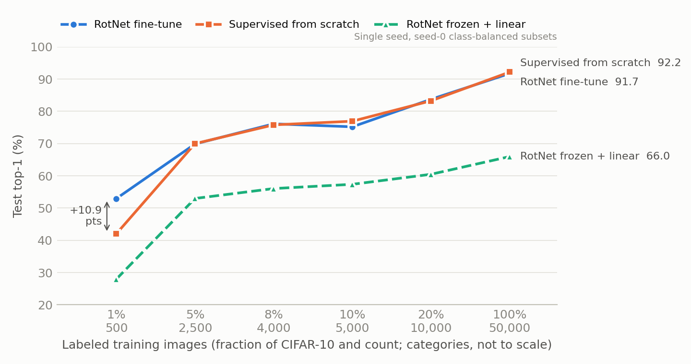

# RotNet results

The Figure B.7 sweep covers five batch sizes and three learning rates, with ten
frozen CIFAR-10 class probes per training run. Bars show mean accuracy, with
sample standard deviation across learning rates. The plot header lists the
random-feature control.

| Measurement | Result |
|---|---:|
| Designated encoder · batch 1024, LR 0.1, epoch 1000 | **65.97%** class top-1 |
| Randomly initialized encoder · same probe | 34.25% class top-1 |
| Range across 150 RotNet probes | 51.36–69.66% class top-1 |
| Final rotation accuracy across the 15 runs | 88.14–93.20% rotation top-1 |

Class top-1 measures recognition of the ten CIFAR-10 categories. Rotation
top-1 measures the four-way prediction task used during pretraining. The
designated encoder was selected by its planned configuration before test scoring.

| Artifact | Contents |
|---|---|
| [Figure PDF](rotnet_figure_b7.pdf) · [Summary CSV](rotnet_figure_b7_summary.csv) | Plot and 50 batch/epoch groups, with accuracy as percentages |
| [Probe CSV](dcc/results/rotnet_linear_probes.csv) · [Probe records](dcc/results/rotnet_linear_probes/) | 150 checkpoint probes plus one random control. CSV accuracies are fractions. |
| [Rotation CSV](dcc/experiments/rotnet_pretrain_rotation_top1.csv) | Pretraining rotation scores as fractions |
| [Campaign record](dcc/campaign.json) · [Run records](dcc/run_records/) · [Slurm logs](dcc/slurm-logs/) | Training array 61863271 and probe array 62101838, with timings and completion evidence |
| [Frozen submission](dcc/results/rotnet_sweep_submissions/20261115T230242708810Z/) | Original receipt, configuration, and source snapshot |

## Part 2 · Limited labels

Each RotNet run starts from the designated encoder above. Fine-tuning trains the
encoder and a new linear classifier; the supervised baseline trains the same
network from random weights on the same subset with the same recipe; the frozen
probe trains only the linear classifier. Single seed, CIFAR-10 test top-1.

| Labels | Images | RotNet fine-tune | Supervised | Difference | RotNet frozen |
|---:|---:|---:|---:|---:|---:|
| 1% | 500 | **52.94%** | 42.02% | **+10.92** | 27.96% |
| 5% | 2,500 | 69.87% | 69.99% | −0.12 | 52.98% |
| 8% | 4,000 | 76.12% | 75.80% | +0.32 | 56.05% |
| 10% | 5,000 | 75.20% | 76.94% | −1.74 | 57.37% |
| 20% | 10,000 | 83.74% | 83.26% | +0.48 | 60.48% |
| 100% | 50,000 | 91.74% | 92.19% | −0.45 | 65.97% |

RotNet initialization helps only at 1%. From 5% onward, fine-tuning and training
from scratch are within 2 points, too small to separate with one seed per run. The
100% frozen probe reproduces the 65.97% anchor score. The frozen probe at 1%
gets 200 optimizer updates in total, so its low value partly reflects the
fixed probe recipe.

| Artifact | Contents |
|---|---|
| [Figure PDF](rotnet_part2_label_fraction.pdf) · [Summary CSV](rotnet_part2_summary.csv) | Plot and the table above, with top-3 columns, as percentages |
| [Results CSV](part2/results.csv) · [Slurm logs](part2/slurm-logs/) | All 18 runs from jobs 62251891 (1%, 10%, 100%) and 62253696 (5%, 8%, 20%). CSV accuracies are fractions. |

Classifier checkpoints remain on DCC under `checkpoints/part2/`.

## Regenerate

To regenerate the published figure and summary from the archived probe CSV,
install Matplotlib and run `python scripts/plot_rotnet_b7.py` from the repository
root. Run `python scripts/plot_rotnet_part2.py` for the Part 2 figure.
Encoder weights are Git-ignored. See the [DCC guide](../../docs/slurm.md)
for the Part 2 job and required checkpoint.
