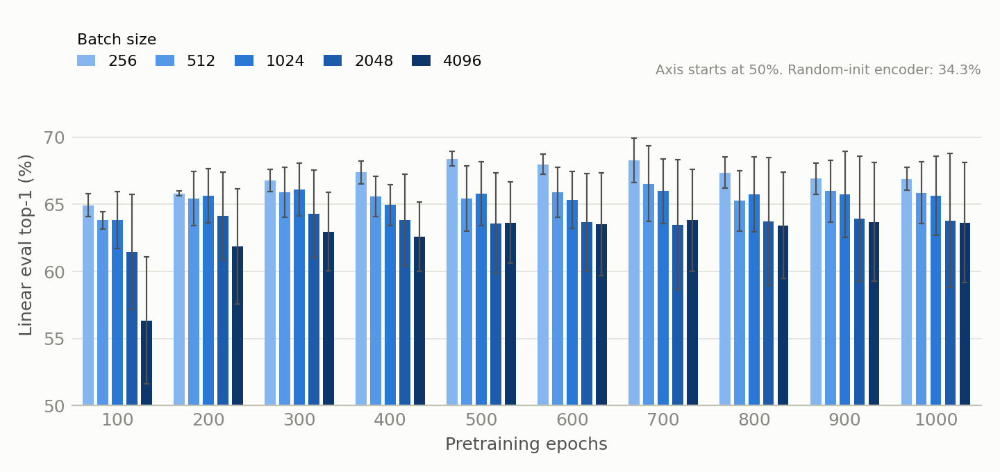

# RotNet results

The Figure B.7 sweep covers five batch sizes and three learning rates, with ten
frozen CIFAR-10 class probes per training run. Bars show mean accuracy, with
sample standard deviation across learning rates. The plot header lists the
random-feature control.

| Measurement | Result |
|---|---:|
| Designated encoder · batch 1024, LR 0.1, epoch 1000 | **65.97%** class top-1 |
| Randomly initialized encoder · same probe | 34.25% class top-1 |
| Range across 150 RotNet probes | 51.36–69.66% class top-1 |
| Final rotation accuracy across the 15 runs | 88.14–93.20% rotation top-1 |

Class top-1 measures recognition of the ten CIFAR-10 categories. Rotation
top-1 measures the four-way prediction task used during pretraining. The
designated encoder was selected by its planned configuration before test scoring.

| Artifact | Contents |
|---|---|
| [Figure PDF](rotnet_figure_b7.pdf) · [Summary CSV](rotnet_figure_b7_summary.csv) | Plot and 50 batch/epoch groups, with accuracy as percentages |
| [Probe CSV](dcc/results/rotnet_linear_probes.csv) · [Probe records](dcc/results/rotnet_linear_probes/) | 150 checkpoint probes plus one random control. CSV accuracies are fractions. |
| [Rotation CSV](dcc/experiments/rotnet_pretrain_rotation_top1.csv) | Pretraining rotation scores as fractions |
| [Campaign record](dcc/campaign.json) · [Run records](dcc/run_records/) · [Slurm logs](dcc/slurm-logs/) | Training array 61863271 and probe array 62101838, with timings and completion evidence |
| [Frozen submission](dcc/results/rotnet_sweep_submissions/20261115T230242708810Z/) | Original receipt, configuration, and source snapshot |

To regenerate the published figure and summary from the archived probe CSV,
install Matplotlib and run `python scripts/plot_rotnet_b7.py` from the repository
root. Encoder weights are Git-ignored. See the [DCC guide](../../docs/slurm.md)
for the Part 2 job and required checkpoint.
